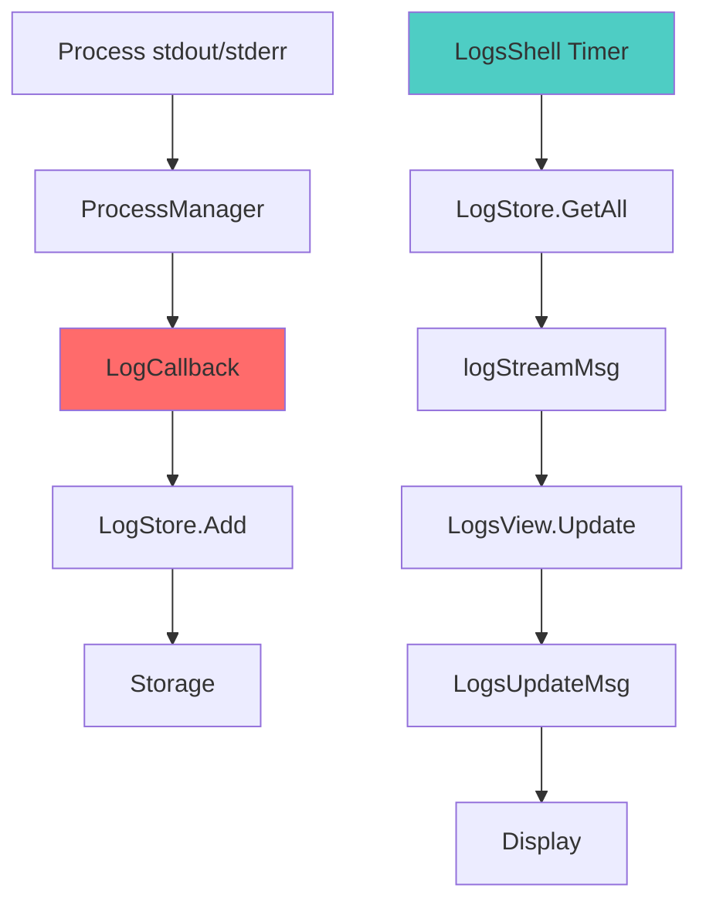
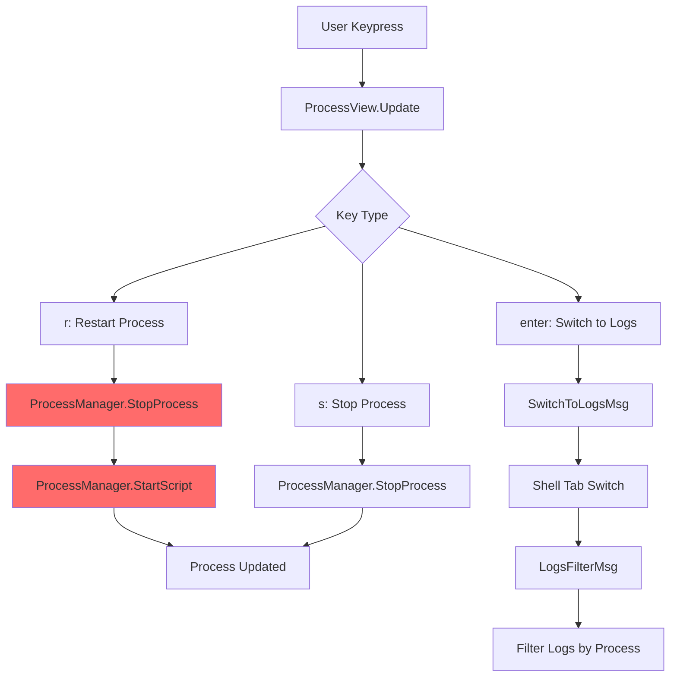
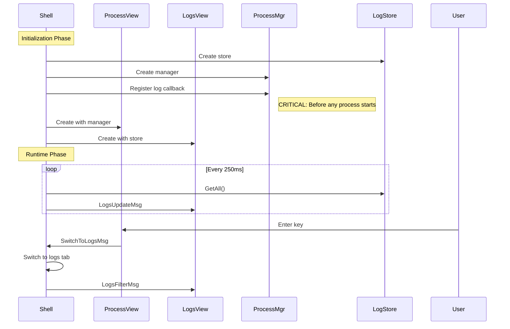
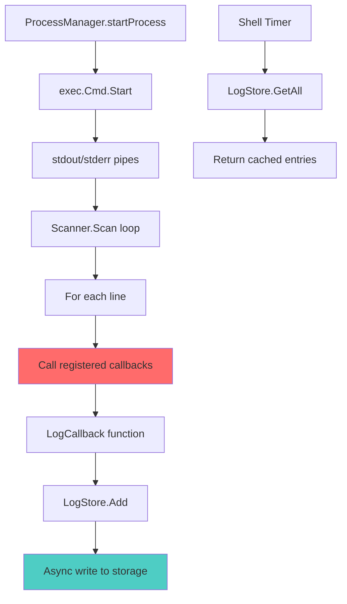
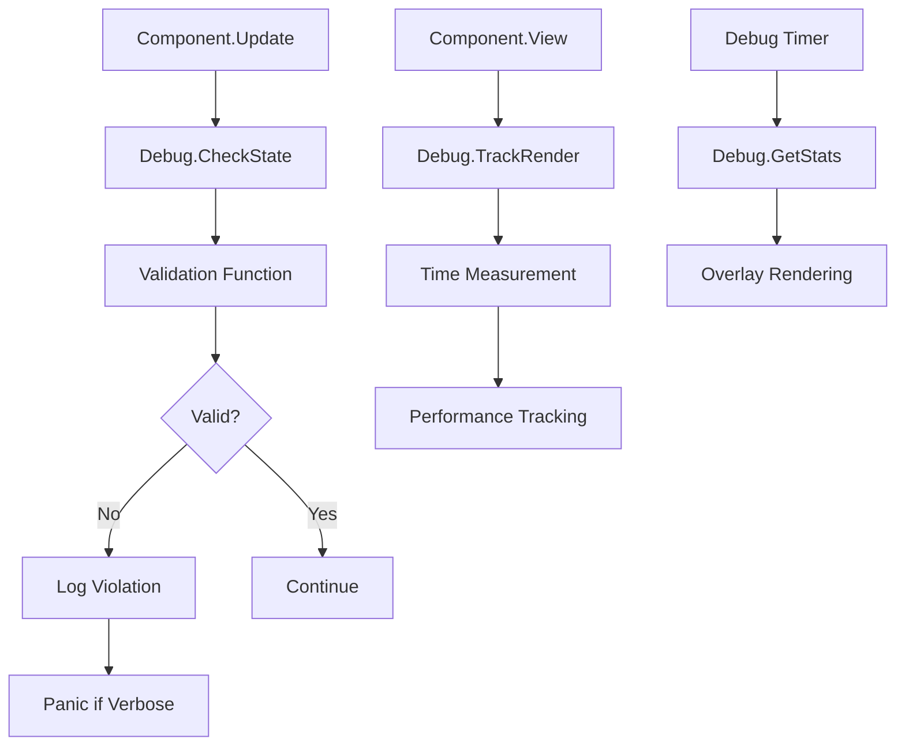

# Data Flow Architecture

This document describes how data flows through the Brummer TUI system, highlighting critical timing requirements, dependencies, and integration points.

## Overview

Brummer follows an **event-driven architecture** with three main data flows:
1. **Process Output → Logs Display** (real-time streaming)
2. **User Input → Component Actions** (command processing)
3. **State Changes → UI Updates** (reactive updates)

## Critical Data Flows

### 1. Process Output Streaming

The most critical flow captures process stdout/stderr and displays it in the logs view:



**⚠️ Critical Requirements:**
- Log callbacks MUST be registered BEFORE starting any process
- Timer polling occurs every 250ms to balance responsiveness vs performance
- LogStore uses fire-and-forget async writes for performance

**⚠️ Common Failure Points:**
1. **Late Callback Registration**: Process output lost if callback registered after process starts
2. **Missing Store**: LogStore nil causes panic in callback
3. **Timer Death**: If streaming timer stops, logs freeze

### 2. Process Management Flow

User actions on processes flow through the process manager:



**⚠️ Critical Requirements:**
- Process operations are async - UI must handle intermediate states
- Failed operations must be gracefully handled
- Selection state must remain valid after process list changes

### 3. Selection State Management

Selection state flows through multiple components:

```mermaid
graph TD
    A[Process List Update] --> B[ProcessView.updateProcessList]
    B --> C{Has Processes?}
    C -->|Yes| D[Auto-select First]
    C -->|No| E[Clear Selection]
    
    D --> F[selectedIndex = 0]
    F --> G[selectedProcess = processes[0].ID]
    
    E --> H[selectedIndex = -1]
    H --> I[selectedProcess = ""]
    
    J[User Up/Down] --> K[Update selectedIndex]
    K --> L[Update selectedProcess]
    L --> M[Validate Bounds]
    M --> N[Update Scroll]
    
    style D fill:#4ecdc4
    style M fill:#ff6b6b
```

**⚠️ Critical Requirements:**
- Selection must be auto-initialized when first process appears
- Selection must be validated when process list changes
- Scroll offset must keep selected item visible

## Integration Points

### ProcessLogsShell Integration

The shell coordinates between components with specific timing:



### Log Callback Chain

The callback chain must be established correctly:



## Error Propagation

Errors flow through the system with different handling strategies:

### Process Errors
```
Process Exit Code → ProcessManager → Process.status update → UI reflects error state
```

### Log Errors
```
LogStore error → Fire-and-forget (logged but UI continues)
Callback error → Logged to stderr (UI continues)
```

### Component Errors
```
Validation error → Debug mode panic/log → Development visibility
Update error → Return error message → User notification
```

## Performance Characteristics

### Update Frequencies
- **Process polling**: Every 1000ms (process state changes)
- **Log polling**: Every 250ms (log streaming)
- **UI rendering**: On-demand (message-driven)

### Memory Management
- **LogStore**: Circular buffer with 1000 entry limit
- **Process list**: Grows unbounded (need cleanup)
- **Component state**: Minimal, mostly references

### Critical Paths Performance
- **Log append**: ~0.1ms (async)
- **Log retrieval**: ~1ms (cached read)
- **Process list update**: ~5ms (process enumeration)
- **UI render**: ~20ms (text formatting + layout)

## Threading Model

Brummer uses a **single-threaded TUI** with **async background workers**:

```
Main Thread: TUI event loop, component updates, rendering
├─ ProcessManager: goroutines per process (stdout/stderr readers)
├─ LogStore: single writer goroutine (async batching)
└─ EventBus: goroutines for event delivery
```

**⚠️ Thread Safety Requirements:**
- All TUI operations must happen on main thread
- Component state modified ONLY in Update() methods
- Use atomic operations for cross-thread reads
- Message passing for cross-thread communication

## State Synchronization

### Process State
```
ProcessManager (authoritative) → ProcessView (cached) → UI Display
```
Updates: Pull-based via GetAllProcesses()

### Log State
```
LogStore (authoritative) → LogsView (filtered cache) → UI Display
```
Updates: Push-based via LogsUpdateMsg

### Selection State
```
ProcessView (authoritative) → Selection maintained locally
```
Updates: Internal state machine

## Debug Mode Data Flow

When `BRUMMER_DEBUG=true`, additional data flows are active:



## Configuration Points

### Environment Variables
- `BRUMMER_DEBUG=true` - Enable debug mode validation
- `BRUMMER_DEBUG_VERBOSE=true` - Panic on violations
- `BRUMMER_LOG_LEVEL=debug` - Increase log verbosity

### Timing Configuration
```go
// In component code - can be made configurable
const (
    LogStreamInterval = 250 * time.Millisecond
    ProcessPollInterval = 1000 * time.Millisecond
    DebugOverlayRefresh = 5000 * time.Millisecond
)
```

## Failure Modes and Recovery

### Log Streaming Failure
**Symptom**: Logs stop updating
**Causes**: Timer stops, LogStore panic, callback unregistered
**Recovery**: Restart shell, check BRUMMER_DEBUG output

### Selection Desync
**Symptom**: Visual selection doesn't match internal state
**Causes**: Process list change without selection validation
**Recovery**: Arrow key press revalidates selection

### Process Manager Freeze
**Symptom**: Process operations don't respond
**Causes**: Deadlock in ProcessManager, resource exhaustion
**Recovery**: Full application restart required

### Memory Growth
**Symptom**: Application becomes slow over time
**Causes**: Unbounded process list, log entry leak
**Recovery**: Implement cleanup in ProcessManager

## Best Practices

### For Component Authors
1. **Never** modify another component's state directly
2. **Always** validate state in debug mode
3. **Use** message passing for cross-component communication
4. **Handle** nil dependencies gracefully

### For Integration
1. **Register** callbacks before starting processes
2. **Initialize** components in dependency order
3. **Cleanup** resources in reverse order
4. **Test** with BRUMMER_DEBUG=true during development

### For Performance
1. **Minimize** allocations in Update() and View()
2. **Cache** expensive computations
3. **Use** atomic operations for cross-thread reads
4. **Profile** regularly with debug mode timing