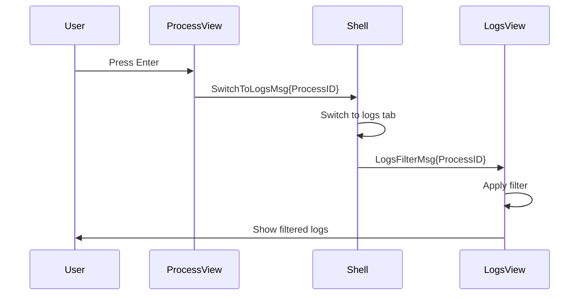
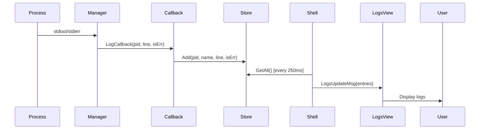

# Component Contracts

This document defines the contracts, responsibilities, and interfaces for all TUI components in Brummer. Each component has clear ownership boundaries, dependencies, and communication patterns.

## Core Principles

1. **Single Responsibility**: Each component owns one aspect of the application
2. **Explicit Dependencies**: All requirements are passed via constructor
3. **Message-Based Communication**: Components communicate via tea.Msg, never direct calls
4. **State Isolation**: Components never directly modify another component's state
5. **Lifecycle Awareness**: Components follow PreInit → Init → Update → Cleanup lifecycle

## Component Contracts

### ProcessViewNew

**Purpose**: Displays and manages running processes with selection and control capabilities

**Owns**:
- Process selection state (`selectedProcess`, `selectedIndex`)
- Visual representation of process list
- Scrolling and navigation state
- Process grouping (running/stopped)

**Requires**:
- `ProcessManager` (read-only access)
- Terminal dimensions via `tea.WindowSizeMsg`

**Provides**:
- `SwitchToLogsMsg` when user selects process logs
- `ProcessUpdateMsg` when processes change
- Visual feedback for process states

**Initialization Contract**:
```go
// Auto-selects first process if available
// Sets selectedIndex to -1 if no processes
// Initializes with focused=false (parent must call Focus())
```

**State Invariants**:
- `selectedIndex` must be within `[0, len(processes)-1]` or -1
- `selectedProcess` must exist in current process list or be empty
- `scrollOffset` must keep selected item visible

---

### LogsViewComponent

**Purpose**: Displays filtered, formatted log entries with search and navigation

**Owns**:
- Log filtering state (text, process, level filters)
- Viewport state (scrolling, following)
- Display preferences (timestamps, wrapping)
- Filtered log cache

**Requires**:
- Initial `LogStore` reference (optional, can work standalone)
- Log entries via `LogsUpdateMsg`
- Terminal dimensions via `tea.WindowSizeMsg`

**Provides**:
- Filtered, formatted log display
- Search and filter capabilities
- Auto-scroll when following

**Initialization Contract**:
```go
// Starts with following=true (auto-scroll enabled)
// Shows all logs by default (no filters)
// Initializes with showTimestamps=true, showProcessID=true
```

**Update Strategies**:
- `LogsUpdateMsg{Append: false}` - Replace all entries (full refresh)
- `LogsUpdateMsg{Append: true}` - Add to existing entries
- `LogsFilterMsg` - Apply filtering without changing entries
- `LogsClearMsg` - Clear all entries

---

### ProcessLogsShell

**Purpose**: Orchestrates ProcessView and LogsView with tab navigation

**Owns**:
- Active tab state
- Tab bar rendering
- Focus management between components
- Component sizing coordination

**Requires**:
- `ProcessManager` for process operations
- `LogStore` for log persistence
- Terminal dimensions

**Provides**:
- Integrated process and logs experience
- Tab-based navigation
- Coordinated component updates

**Initialization Contract**:
```go
// MUST register log callbacks before any processes start
// Starts with Processes tab active (index 0)
// Ensures log callback → store → view pipeline is connected
```

**Critical Setup Order**:
1. Create LogStore
2. Create ProcessManager
3. **Register log callbacks** (before starting any process)
4. Create components
5. Start streaming logs

---

## Message Flow Contracts

### Process Selection → Logs Filter



### Process Output → Log Display



## State Machines

### ProcessView Selection State

```
State: NO_PROCESSES
├─ selectedIndex: -1
├─ selectedProcess: ""
└─ Transition: processes loaded → HAS_SELECTION

State: HAS_SELECTION  
├─ selectedIndex: [0, len-1]
├─ selectedProcess: valid ID
└─ Transitions:
    ├─ up/down → update selection
    ├─ process removed → validate selection
    └─ all removed → NO_PROCESSES
```

### LogsView Following State

```
State: FOLLOWING
├─ following: true
├─ viewport: auto-scrolls to bottom
└─ Transition: user scrolls up → PAUSED

State: PAUSED
├─ following: false  
├─ viewport: user-controlled
└─ Transition: 'f' key → FOLLOWING
```

## Lifecycle Contracts

### Component Initialization Order

```go
// 1. PreInit - Validate dependencies exist
func (c *Component) PreInit() error {
    if c.dependency == nil {
        return fmt.Errorf("missing required dependency")
    }
    return nil
}

// 2. Init - Initialize state, return initial commands
func (c *Component) Init() tea.Cmd {
    c.initializeState()
    return c.startBackgroundTasks()
}

// 3. PostInit - Verify successful initialization
func (c *Component) PostInit() error {
    if !c.isValidState() {
        return fmt.Errorf("invalid state after init")
    }
    return nil
}

// 4. Update - Handle messages (running)
func (c *Component) Update(msg tea.Msg) (tea.Model, tea.Cmd)

// 5. Cleanup - Release resources
func (c *Component) Cleanup() error {
    c.stopBackgroundTasks()
    return nil
}
```

## Common Pitfalls and Solutions

### Pitfall 1: Late Callback Registration
**Problem**: Registering log callbacks after processes start loses early output
**Solution**: Always register callbacks in shell constructor, before any process starts

### Pitfall 2: Uninitialized Selection
**Problem**: Process view doesn't select anything by default
**Solution**: Auto-select first process in `updateProcessList()`

### Pitfall 3: Log Duplication
**Problem**: Appending logs repeatedly causes duplicates  
**Solution**: Use replace strategy or deduplication in log store

### Pitfall 4: Focus Loss
**Problem**: Components lose focus during updates
**Solution**: Parent component must manage focus explicitly via Focus()/Blur()

### Pitfall 5: Size Desync
**Problem**: Components render incorrectly after resize
**Solution**: Always propagate WindowSizeMsg to all components

## Testing Requirements

Each component must have tests for:

1. **Initialization**: Correct default state
2. **State Transitions**: All state machine paths
3. **Message Handling**: All message types
4. **Edge Cases**: Empty data, invalid input
5. **Lifecycle**: Proper cleanup

## Debug Mode Validation

When `BRUMMER_DEBUG=true`, components perform runtime validation:

```go
func (c *ProcessViewNew) validateState() {
    // Called in Update() when debug mode enabled
    if c.selectedIndex >= len(c.processes) && c.selectedIndex != -1 {
        panic(fmt.Sprintf("Invalid selection: index=%d, processes=%d", 
            c.selectedIndex, len(c.processes)))
    }
    if c.selectedProcess != "" && !c.hasProcess(c.selectedProcess) {
        panic(fmt.Sprintf("Selected process doesn't exist: %s", 
            c.selectedProcess))
    }
}
```

## Component Communication Matrix

| From ↓ To → | ProcessView | LogsView | Shell | Store |
|-------------|-------------|----------|-------|-------|
| ProcessView | - | SwitchToLogsMsg | ProcessUpdateMsg | READ |
| LogsView | - | - | - | READ |
| Shell | Focus/Blur | LogsUpdateMsg | - | GetAll |
| Manager | - | - | - | via Callback |

Legend:
- READ: Read-only access
- Message: Communicates via message
- Direct: Direct method call (only for focus management)