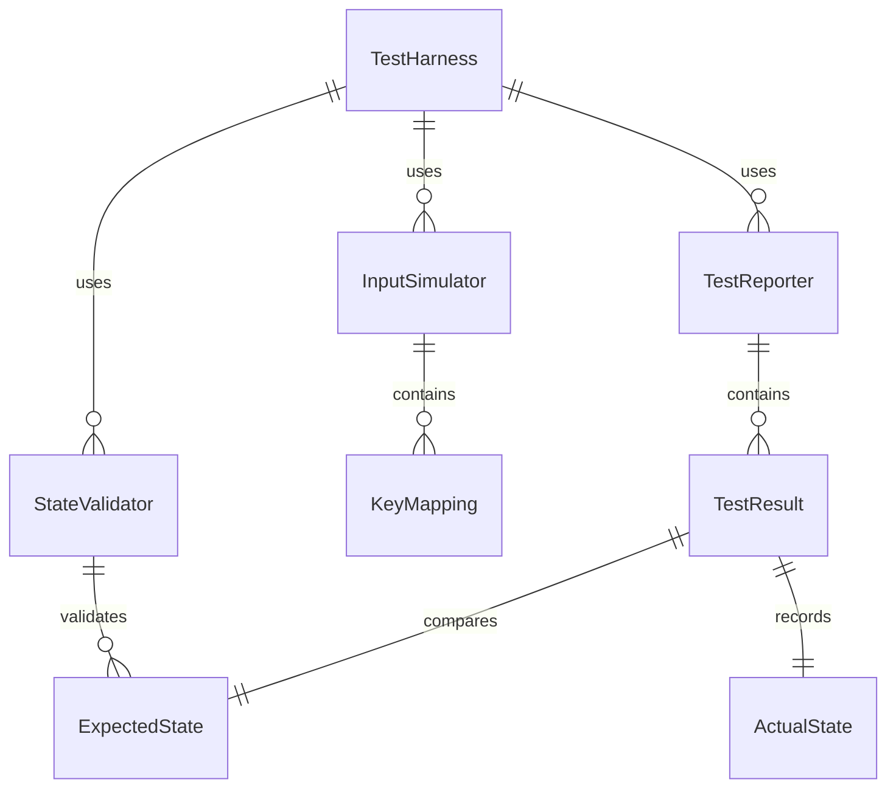

# Phase 1: Data Model

**Feature**: TUI Integration Testing Harness
**Date**: 2025-01-12
**Based on**: Research findings and feature specification

## Entity Overview

The TUI Integration Testing Harness introduces several key entities to enable automated testing of terminal interface functionality without requiring TTY allocation.

## Core Entities

### 1. TestHarness

**Purpose**: Main testing framework coordinator

**Fields**:
- `ID`: Unique identifier for the test harness instance
- `Config`: TestHarnessConfiguration (testing parameters and settings)
- `Simulator`: InputSimulator (keyboard input simulation component)
- `Validator`: StateValidator (TUI state validation component)
- `Reporter`: TestReporter (test execution reporting component)
- `Status`: TestHarnessStatus (current testing status)

**State Transitions**:
- `Initializing` → `Ready` → `Running` → `Completed` → `Failed`

**Validation Rules**:
- ID must be unique across all test harness instances
- Config cannot be null and must contain valid test parameters
- All components must be properly initialized before transitioning to `Ready` state

### 2. InputSimulator

**Purpose**: Generates keyboard input events for testing

**Fields**:
- `ID`: Unique identifier for the simulator instance
- `KeyMappings`: []KeyMapping (mapping of test actions to keyboard inputs)
- `CurrentSequence`: []tea.KeyMsg (current input sequence being generated)
- `Timing`: TimingConfiguration (input timing and delay settings)

**Key Operations**:
- GenerateKeySequence(action) → []tea.KeyMsg
- SimulateKeyPress(key) → tea.KeyMsg
- ValidateInputSequence(sequence) → error

**Validation Rules**:
- KeyMappings cannot contain duplicate action mappings
- CurrentSequence must contain valid tea.KeyMsg instances
- Timing delays must be non-negative values

### 3. StateValidator

**Purpose**: Validates TUI state changes during testing

**Fields**:
- `ID`: Unique identifier for the validator instance
- `ExpectedStates`: []ExpectedState (expected state transitions)
- `ActualStates`: []ActualState (captured actual states)
- `ValidationRules`: []ValidationRule (custom validation logic)

**State Operations**:
- CaptureState(model) → StateSnapshot
- ValidateTransition(from, to) → ValidationResult
- CompareStates(expected, actual) → ComparisonResult

**Validation Rules**:
- ExpectedStates must be in chronological order
- ActualStates must correspond to input sequence timing
- ValidationRules must have deterministic outcomes

### 4. TestReporter

**Purpose**: Generates detailed test execution reports

**Fields**:
- `ID`: Unique identifier for the reporter instance
- `TestResults`: []TestResult (individual test execution results)
- `Metrics`: TestMetrics (performance and coverage metrics)
- `ReportFormat`: ReportFormat (output format configuration)

**Reporting Operations**:
- GenerateReport() → Report
- AddTestResult(result) → error
- CalculateMetrics() → TestMetrics

**Validation Rules**:
- TestResults must contain complete execution information
- Metrics calculations must be consistent and reproducible
- ReportFormat must be supported by the reporter

## Supporting Entities

### 5. TestHarnessConfiguration

**Purpose**: Configuration parameters for test execution

**Fields**:
- `TestTimeout`: time.Duration (maximum test execution time)
- `KeyInputDelay`: time.Duration (delay between simulated key inputs)
- `StateValidation`: bool (enable/disable state validation)
- `ReportLevel`: ReportLevel (detail level for test reports)
- `TestScope`: TestScope (scope of tests to execute)

### 6. KeyMapping

**Purpose**: Maps test actions to keyboard input sequences

**Fields**:
- `Action`: string (test action identifier)
- `KeySequence`: []tea.KeyMsg (keyboard input sequence)
- `Description`: string (human-readable description)
- `Preconditions`: []string (required preconditions for action)

### 7. ExpectedState

**Purpose**: Defines expected TUI state after input

**Fields**:
- `TriggerAction`: string (action that triggers this state)
- `ViewType`: ViewType (expected active view)
- `SelectedProcess`: string (expected selected process)
- `ModelState`: map[string]interface{} (expected model state)
- `Timeout`: time.Duration (maximum time to reach state)

### 8. TestResult

**Purpose**: Represents individual test execution result

**Fields**:
- `TestID`: string (unique test identifier)
- `Action`: string (tested action)
- `ExpectedState`: ExpectedState (expected outcome)
- `ActualState`: ActualState (actual outcome)
- `Status`: TestStatus (pass/fail/error)
- `Duration`: time.Duration (test execution duration)
- `Error`: error (any error encountered)
- `Timestamp`: time.Time (test execution timestamp)

## Relationships

## Data Flow

1. **Test Initialization**: TestHarness creates and configures components
2. **Input Simulation**: InputSimulator generates keyboard sequences
3. **State Capture**: StateValidator captures TUI states during execution
4. **Validation**: StateValidator compares actual vs expected states
5. **Reporting**: TestReporter generates comprehensive test reports

## Constraints and Invariants

### Constraints
- Test execution cannot exceed configured timeout
- Keyboard input sequences must be valid for BubbleTea framework
- State validation must be deterministic
- Test reports must contain complete execution information

### Invariants
- TestHarness status accurately reflects current testing state
- InputSimulator maintains consistent key mapping state
- StateValidator maintains chronological state sequence
- TestReporter maintains accurate test execution metrics

## Performance Considerations

- State snapshots should be captured efficiently to minimize test overhead
- Key input simulation should be realistic but not unnecessarily delayed
- Test reports should be generated incrementally to avoid memory issues
- Component communication should use lock-free patterns per Brummer Constitution

## Integration Points

### Existing Brummer Components
- **EventBus**: Used for component communication
- **InputService**: Integrated for realistic input testing
- **NavigationService**: Used for view switching validation
- **Model Components**: Directly tested through model interface

### Testing Framework Integration
- **Go Testing Framework**: Primary testing infrastructure
- **BubbleTea Testing**: Leveraged for model and view testing
- **Pre-commit Hooks**: Integration for automated testing
- **CI/CD Pipeline**: Integration for automated validation

This data model provides the foundation for implementing a comprehensive TUI testing harness that meets all functional requirements while maintaining compatibility with existing Brummer architecture.