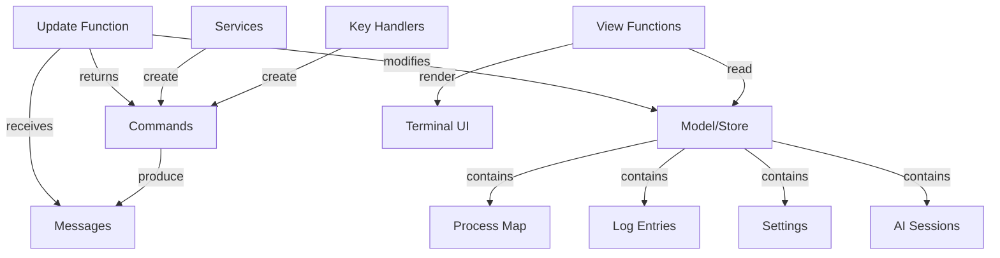

# Data Model: TUI and Service Architecture Simplification

**Feature**: Redux/Elm Architecture Pattern
**Date**: 2025-01-13

## Core Entities

### 1. Model (Central State Store)
```go
type Model struct {
    // View Management
    currentView     View              // Active view
    viewHistory     []View            // Navigation history
    viewManager     *ViewManager      // Atomic view state

    // Process State
    processes       map[string]*Process  // All processes by ID
    activeProcessID string               // Currently selected process
    processManager  *ProcessManager      // Process lifecycle management

    // Log State
    logs            []LogEntry        // All log entries
    filteredLogs    []LogEntry        // Currently filtered logs
    logFilter       string            // Active filter
    scrollOffset    int               // Scroll position

    // Error State
    errors          []ErrorEntry      // All errors
    errorCounts     map[string]int    // Error frequency by type

    // URL State
    urls            map[string][]URL  // URLs by process ID
    activeURL       string            // Selected URL

    // AI Coder State
    aiSessions      map[string]*AISession  // Active AI sessions
    activeSessionID string                 // Current session

    // Settings
    settings        Settings          // User configuration
    theme           Theme             // UI theme

    // UI State
    windowWidth     int               // Terminal width
    windowHeight    int               // Terminal height
    isFullscreen    bool              // Fullscreen mode

    // Command Palette
    paletteVisible  bool              // Palette open/closed
    paletteQuery    string            // Search query
    paletteResults  []Command         // Filtered commands
}
```

### 2. Messages (Events/Actions)
```go
// View Messages
type ViewSwitchedMsg struct {
    PreviousView View
    NewView      View
    Timestamp    time.Time
}

type ViewHistoryBackMsg struct{}
type ViewHistoryForwardMsg struct{}

// Process Messages
type ProcessStartedMsg struct {
    Process *Process
}

type ProcessStoppedMsg struct {
    ProcessID string
    ExitCode  int
}

type ProcessOutputMsg struct {
    ProcessID string
    Line      string
    Stream    StreamType // stdout/stderr
}

// Log Messages
type LogFilterChangedMsg struct {
    Filter string
}

type LogScrollMsg struct {
    Direction ScrollDirection
    Amount    int
}

// Error Messages
type ErrorDetectedMsg struct {
    ProcessID string
    Error     error
    Context   string
}

// URL Messages
type URLDiscoveredMsg struct {
    ProcessID string
    URL       string
    Label     string
}

type URLOpenRequestMsg struct {
    URL string
}

// AI Coder Messages
type AISessionStartedMsg struct {
    Session *AISession
}

type AISessionEndedMsg struct {
    SessionID string
}

type AIResponseMsg struct {
    SessionID string
    Response  string
}

// Settings Messages
type SettingsUpdatedMsg struct {
    Settings Settings
}

type ThemeChangedMsg struct {
    Theme Theme
}

// Window Messages
type WindowResizedMsg struct {
    Width  int
    Height int
}

// Command Palette Messages
type PaletteOpenMsg struct{}
type PaletteCloseMsg struct{}
type PaletteQueryMsg struct {
    Query string
}
type PaletteSelectMsg struct {
    Command Command
}
```

### 3. Commands (Side Effects)
```go
// Process Commands
func StartProcess(name, cmd string) tea.Cmd
func StopProcess(id string) tea.Cmd
func RestartProcess(id string) tea.Cmd
func WatchProcessOutput(id string) tea.Cmd

// Log Commands
func LoadLogs(processID string) tea.Cmd
func SaveLogsToFile(logs []LogEntry, path string) tea.Cmd
func StreamLogs(processID string) tea.Cmd

// URL Commands
func OpenURLInBrowser(url string) tea.Cmd
func CopyURLToClipboard(url string) tea.Cmd
func TestURLConnection(url string) tea.Cmd

// AI Coder Commands
func StartAISession(config AIConfig) tea.Cmd
func SendToAI(sessionID, prompt string) tea.Cmd
func EndAISession(sessionID string) tea.Cmd

// Settings Commands
func LoadSettings() tea.Cmd
func SaveSettings(settings Settings) tea.Cmd
func ApplyTheme(theme Theme) tea.Cmd

// System Commands
func CheckForUpdates() tea.Cmd
func ExportState(model Model) tea.Cmd
func ImportState(path string) tea.Cmd
```

### 4. Services (Stateless Command Creators)
```go
// ProcessService - Creates commands for process operations
type ProcessService struct {
    workDir string
    env     []string
}

func (s *ProcessService) Start(name, cmd string) tea.Cmd
func (s *ProcessService) Stop(id string) tea.Cmd
func (s *ProcessService) Restart(id string) tea.Cmd
func (s *ProcessService) GetOutput(id string) tea.Cmd

// LogService - Creates commands for log operations
type LogService struct {
    logDir string
}

func (s *LogService) Load(processID string) tea.Cmd
func (s *LogService) Save(logs []LogEntry, path string) tea.Cmd
func (s *LogService) Stream(processID string) tea.Cmd
func (s *LogService) Filter(logs []LogEntry, query string) []LogEntry

// ConfigService - Creates commands for configuration
type ConfigService struct {
    configPath string
}

func (s *ConfigService) Load() tea.Cmd
func (s *ConfigService) Save(settings Settings) tea.Cmd
func (s *ConfigService) Validate(settings Settings) error
```

## Entity Relationships



## State Transitions

### View State Machine
```
IDLE -> SWITCHING -> NEW_VIEW -> IDLE
         ↓
      ERROR -> IDLE
```

### Process Lifecycle
```
PENDING -> STARTING -> RUNNING -> STOPPING -> STOPPED
            ↓            ↓           ↓
          FAILED      CRASHED     KILLED
```

### AI Session States
```
INACTIVE -> CONNECTING -> READY -> PROCESSING -> READY
              ↓             ↓         ↓
           ERROR        TIMEOUT   CANCELLED
```

## Validation Rules

### Model Validation
- `currentView` must be one of the 7 defined views
- `processes` map keys must match Process.ID
- `windowWidth` and `windowHeight` must be > 0
- `scrollOffset` must be >= 0 and < len(logs)

### Message Validation
- All messages must have timestamp if time-sensitive
- Process IDs in messages must exist in Model.processes
- View transitions must be to valid views
- Filter queries must be valid regex if regex mode enabled

### Command Validation
- Commands must return tea.Msg or nil
- Async commands must handle timeouts
- File operations must check permissions
- Network operations must handle offline mode

## Data Constraints

### Performance Constraints
- Model updates must complete in <1ms
- View renders must complete in <16ms (60fps)
- Message handling must be non-blocking
- Commands must timeout after 30s max

### Memory Constraints
- Log buffer limited to 10,000 entries
- Process history limited to last 100
- URL cache limited to 1,000 entries
- Error history limited to last 500

### Concurrency Constraints
- Model is single-threaded (BubbleTea constraint)
- Services must be thread-safe
- Commands run in separate goroutines
- Atomic operations for concurrent reads

## Migration Notes

### From Current Architecture
1. Extract state from services into Model
2. Convert service methods to return tea.Cmd
3. Move state mutations to Update function
4. Convert handlers to use commands
5. Make views pure rendering functions

### Backward Compatibility
- Settings format unchanged
- Configuration files compatible
- Keyboard shortcuts preserved
- API contracts maintained

## Testing Considerations

### Unit Test Targets
- Update function with all message types
- Service command creators
- View rendering functions
- Validation rules

### Integration Test Scenarios
- Complete user workflows
- View navigation flows
- Process lifecycle management
- Error recovery paths

### Performance Benchmarks
- Update function throughput
- View rendering speed
- Command execution time
- Memory usage patterns

---
*Data model designed for Redux/Elm architecture with BubbleTea runtime*