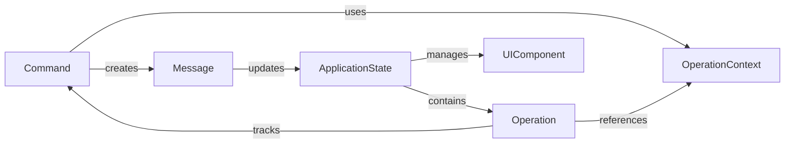

# Data Model: Bubble Tea MVU Pattern

## Core Entities

### 1. Command
**Purpose**: Base interface for all asynchronous operations in Bubble Tea
**Fields**:
- `ID` (string): Unique identifier for tracking and correlation
- `Type` (CommandType): Categorization for routing and handling
- `Priority` (int): Execution priority for command scheduler
- `Context` (OperationContext): Metadata for ordering and versioning
- `CreatedAt` (time.Time): Timestamp for timeout and performance tracking

**Validation Rules**:
- ID must be unique per session
- Priority must be between 0-10 (0 = highest)
- Context must include version for state operations

**State Transitions**:
- Created → Queued → Executing → Completed/Failed

### 2. Message
**Purpose**: Event types for command results and state updates
**Fields**:
- `ID` (string): Correlation with originating command
- `Type` (MessageType): Result, error, progress, or state change
- `Payload` (interface{}): Type-specific data
- `Error` (error): Error information if operation failed
- `Timestamp` (time.Time): When message was created
- `RetryCount` (int): Number of retry attempts if applicable

**Validation Rules**:
- Must correlate to existing or system command
- Error and Payload are mutually exclusive for result messages
- RetryCount must not exceed configured maximum (3)

**State Transitions**:
- N/A (messages are immutable events)

### 3. ApplicationState
**Purpose**: Central state managed by Bubble Tea Update function
**Fields**:
- `Version` (uint64): Monotonic version for change tracking
- `UIState` (UIState): Current UI component states
- `Operations` (map[string]*Operation): Active operations tracking
- `Cache` (StateCache): Cached results with TTL
- `LastUpdate` (time.Time): Last state modification time
- `ResponseTime` (time.Duration): Rolling average response time

**Validation Rules**:
- Version must increment on every update
- Operations map size must not exceed max concurrent (framework-managed)
- ResponseTime must be calculated over last 100 operations

**State Transitions**:
- State changes only through Update() function
- Atomic version increment on each change

### 4. OperationContext
**Purpose**: Metadata for command execution and result handling
**Fields**:
- `OperationType` (string): Category of operation (UI, Data, System)
- `Version` (uint64): State version when operation initiated
- `Dependencies` ([]string): IDs of operations that must complete first
- `Strategy` (OrderingStrategy): How to handle out-of-order completion
- `Timeout` (time.Duration): Maximum execution time
- `RetryPolicy` (RetryPolicy): How to handle failures

**Validation Rules**:
- Version must match current state for write operations
- Dependencies must reference existing operations
- Timeout must be positive and reasonable (<30s)

**State Transitions**:
- Immutable once created

### 5. Operation
**Purpose**: Tracking structure for in-flight asynchronous operations
**Fields**:
- `ID` (string): Unique operation identifier
- `Command` (Command): Original command being executed
- `Status` (OperationStatus): Current execution state
- `StartTime` (time.Time): When execution began
- `EndTime` (time.Time): When execution completed
- `Result` (interface{}): Operation result if successful
- `Error` (error): Error if operation failed
- `Retries` (int): Number of retry attempts made

**Validation Rules**:
- Status transitions must follow valid state machine
- EndTime must be after StartTime when set
- Retries must not exceed RetryPolicy maximum

**State Transitions**:
- Pending → Running → Completed/Failed/Cancelled

### 6. UIComponent
**Purpose**: State for individual UI components (tabs, views, inputs)
**Fields**:
- `ID` (string): Component identifier
- `Type` (ComponentType): Tab, View, Input, etc.
- `Active` (bool): Whether component is currently active
- `Data` (interface{}): Component-specific state data
- `Loading` (bool): Whether component is awaiting data
- `Error` (error): Component-specific error state
- `LastUpdate` (time.Time): Last modification time

**Validation Rules**:
- Only one component of same type can be active
- Loading and Error are mutually exclusive
- Data must match expected type for component

**State Transitions**:
- Inactive → Active → Loading → Loaded/Error → Inactive

## Relationships



## Type Definitions

### Enumerations

```go
type CommandType int
const (
    CommandTypeIO CommandType = iota
    CommandTypeProcess
    CommandTypeNetwork
    CommandTypeSystem
)

type MessageType int
const (
    MessageTypeResult MessageType = iota
    MessageTypeError
    MessageTypeProgress
    MessageTypeStateChange
)

type OperationStatus int
const (
    OperationPending OperationStatus = iota
    OperationRunning
    OperationCompleted
    OperationFailed
    OperationCancelled
)

type OrderingStrategy int
const (
    OrderingLastWriteWins OrderingStrategy = iota
    OrderingVersionTracking
    OrderingQueueSequential
    OrderingParallelMerge
)

type ComponentType int
const (
    ComponentTypeTab ComponentType = iota
    ComponentTypeView
    ComponentTypeInput
    ComponentTypeOverlay
)
```

### Complex Types

```go
type RetryPolicy struct {
    MaxAttempts   int
    InitialDelay  time.Duration
    MaxDelay      time.Duration
    BackoffFactor float64
    RetryableErrors []error
}

type StateCache struct {
    entries map[string]CacheEntry
    mu      sync.RWMutex
}

type CacheEntry struct {
    Value     interface{}
    ExpiresAt time.Time
    Version   uint64
}

type UIState struct {
    ActiveTab    string
    ActiveView   string
    CommandInput string
    Selections   map[string]int
    ScrollPositions map[string]int
}
```

## Constraints

### Performance Constraints
- State updates must complete within 5ms
- Command creation overhead must be <1ms
- Message handling must not block Update()
- Cache lookups must be O(1)

### Concurrency Constraints
- No direct goroutine creation in TUI code
- All async operations through command pattern
- State modifications only in Update()
- Read-only access to state in View()

### Memory Constraints
- Operation tracking map limited to 100 entries
- Cache size limited to 1000 entries
- Message queue depth limited to 500
- Component state must be <1KB each

## Validation Rules Summary

1. **Command Validation**:
   - Unique IDs required
   - Valid priority range (0-10)
   - Context must include version for state operations

2. **Message Validation**:
   - Must correlate to command or system event
   - Type-specific payload validation
   - Timestamp must be monotonic

3. **State Validation**:
   - Version must increment monotonically
   - Single active component per type
   - Response time calculation accuracy

4. **Operation Validation**:
   - Valid state transitions only
   - Timeout enforcement
   - Retry limit enforcement

5. **Context Validation**:
   - Version matching for writes
   - Valid dependency references
   - Reasonable timeout values